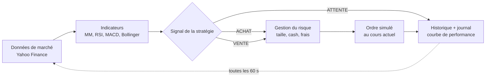
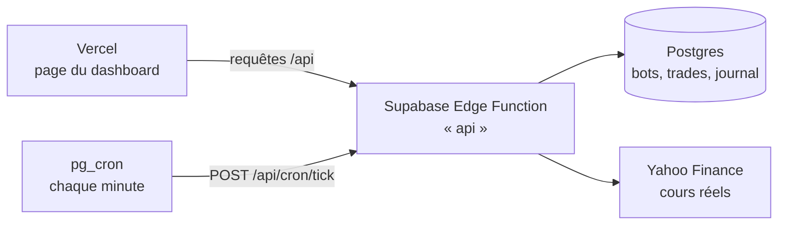

# TradeBot — bot de trading algorithmique (TIP)

Application web qui fait tourner un ou plusieurs **bots de trading** sur les **cours réels** du marché (actions américaines, suisses,
européennes, ETF, cryptos), avec un **capital fictif** choisi au départ. C'est du *paper trading* : les ordres sont simulés, aucun
argent réel n'est engagé.

Projet réalisé dans le cadre du TIP « Le trading algorithmique et l'intelligence artificielle en bourse ».

**La question du projet : peut-on investir avec un robot, sans prendre soi-même aucune décision ?** La personne, qui n'y connaît
rien, répond seulement à un questionnaire. Le bot fait tout le reste : il choisit les actions, décide quand acheter et vendre, et
protège l'argent selon le risque accepté.

## Fonctionnalités

- **Questionnaire d'investisseur** (une question par écran, pensé pour le téléphone) : horizon, part de l'épargne, réserve de
  secours, objectif, réaction à une baisse, perte maximale acceptée, expérience, deux questions de connaissances (avec la bonne
  réponse expliquée), préférences (Suisse, monde, tech, cryptos), entreprises favorites, montant, devise et banque.
- **Profil de risque** en 5 niveaux (très prudent → audacieux), calculé comme dans les banques suisses (LSFin) : capacité de risque,
  tolérance au risque et connaissances ; le plus prudent des trois l'emporte. Les réponses contradictoires sont signalées.
- **Choix des actions par le bot** : il mesure la volatilité sur un an d'une soixantaine de placements (actions suisses, américaines,
  européennes, fonds, obligations, or, cryptos) et remplit chaque « case » du profil (très calme, calme, moyen, agité…) avec le
  placement au meilleur rapport gain / risque, sans plus de deux placements par secteur. Les favoris de la personne sont ajoutés.
- **Réglages automatiques** selon le profil : placements choisis, réserve de liquidités et **limite de perte globale** (si le
  placement baisse plus que la perte acceptée, le bot vend tout et se met en pause). Le bot achète puis garde : nos tests sur 5 ans de
  vrais cours (frais réels de Yuh) montrent qu'acheter et vendre souvent, par exemple en suivant la tendance, rapporte nettement
  moins pour un petit investisseur (+19 % au lieu de +61 % pour le profil équilibré, de mars 2022 à octobre 2026). Ce résultat est
  expliqué dans la page « Comprendre ».
- **Simulation du passé avant de lancer** : le bot rejoue ses règles sur les vrais cours des 2 dernières années, frais compris,
  et compare avec « acheter et garder ».
- **Mode expert** (depuis la page « Comprendre ») : créer un bot à la main et tester toutes les stratégies sur le passé.

- **Création de bots** : capital de départ et devise du compte (CHF, EUR ou USD), banque dont le bot paie les tarifs, actions suivies
  (recherche par nom ou listes prêtes : Tech US, SMI, Europe, crypto… ; on peut mélanger les bourses), stratégie et ses paramètres,
  unité de temps des bougies (5 min → 1 jour), gestion du risque (taille de position, stop-loss, take-profit, fractions d'actions).
- **Frais réels** : chaque ordre paie ce qu'il coûterait vraiment à un investisseur suisse, ligne par ligne :
  - le courtage selon le barème de la banque choisie (Yuh, Swissquote, PostFinance ou Interactive Brokers) ;
  - le change au vrai taux du moment (Yahoo Finance), avec la marge de la banque ;
  - le droit de timbre fédéral (0,075 % / 0,15 %, seulement chez une banque suisse) ;
  - les taxes étrangères : taxe française de 0,4 %, droit de timbre britannique de 0,5 %, frais SEC/FINRA américains.

  Un mode « frais simplifiés » (un pourcentage fixe) reste disponible. Tarifs relevés le 12.10.2026 (sources dans
  `server/trading/costs.ts`).
- **Bot en direct** : toutes les 60 secondes, il récupère les cours réels (Yahoo Finance), calcule ses indicateurs et passe des ordres
  simulés pendant les heures d'ouverture de la bourse.
- **Dashboard** : valeur du portefeuille, performance, comparaison avec le *Buy & Hold*, liquidités, drawdown maximal, positions ouvertes
  avec gain/perte latent, graphique en chandeliers avec les indicateurs et les achats/ventes du bot.
- **Historique complet des trades** : date, prix, quantité, frais, résultat, et **la raison de chaque décision**
  (ex. « RSI à 27.4 < 30 : titre survendu »). Export CSV pour Excel.
- **Journal du bot** : chaque analyse, signal, ordre, ouverture/fermeture de marché.
- **Backtest** : rejoue une stratégie sur jusqu'à 10 ans d'historique réel et calcule rendement, drawdown, ratio de Sharpe,
  taux de réussite, profit factor… comparés au Buy & Hold.
- **Page « Comment ça marche »** : explication de l'algorithme, des indicateurs (avec formules) et des limites.
- Pause / reprise, analyse immédiate, vente manuelle d'une position, réinitialisation.

## Démarrage rapide

Prérequis : [Node.js](https://nodejs.org) **22.13 ou plus récent** (la version LTS actuelle convient).

```bash
npm install
npm run dev
```

Ouvrez ensuite <http://localhost:5173>. Le serveur (API + bot) tourne sur le port 3001, le dashboard sur le port 5173.

### Version « production » (un seul serveur)

```bash
npm install
npm run build      # génère le dashboard dans dist/web
npm start          # serveur + dashboard sur http://localhost:3001
```

> Le bot ne fonctionne que tant que le serveur tourne. Pour qu'il trade pendant des jours ou des semaines, il faut l'héberger sur une
> machine allumée en permanence (voir « Mise en ligne »).

## Comment fonctionne le bot



À chaque cycle (« tick »), pour chaque action suivie :

1. **Données** : le bot télécharge les dernières bougies et le cours actuel.
2. **Stop-loss / take-profit** : si une position est ouverte et que le cours a franchi un seuil, elle est vendue immédiatement.
3. **Signal** : uniquement quand une nouvelle bougie vient de se **clôturer** (une bougie en cours peut encore changer), la stratégie
   calcule ses indicateurs et renvoie ACHAT, VENTE ou ATTENTE, avec une explication.
4. **Exécution** : l'ordre est simulé au cours actuel, converti dans la devise du compte au taux de change du moment. Un achat investit
   *x %* de la valeur du portefeuille (sans dépasser le cash), tous frais compris (courtage, change, droit de timbre, taxes). Une vente
   solde toute la position et calcule le gain/perte réalisé, frais d'achat et de vente inclus.
5. **Suivi** : la valeur du portefeuille est enregistrée et comparée au **Buy & Hold** (les mêmes actions achetées à parts égales au
   lancement du bot).

Les ordres ne sont passés que pendant les heures d'ouverture de la bourse de chaque action. Un bot en pause continue de suivre les cours
(la valeur du portefeuille évolue) mais ne passe aucun ordre.

### Stratégies disponibles

| Stratégie | Type | Achat | Vente |
|---|---|---|---|
| Suivre la tendance (utilisée par le questionnaire) | suivi de tendance | clôture au-dessus de sa moyenne mobile | clôture à plus de x % sous la moyenne (marge anti-allers-retours) |
| Croisement de moyennes mobiles | suivi de tendance | MM courte croise MM longue vers le haut | croisement vers le bas |
| RSI | retour à la moyenne | RSI < 30 (survendu) | RSI > 70 (suracheté) |
| MACD | momentum | MACD croise sa ligne de signal vers le haut | croisement vers le bas |
| Bandes de Bollinger | statistique | clôture sous la bande basse (moyenne − 2σ) | retour à la moyenne |
| Score multi-indicateurs | modèle de décision | tendance + RSI + MACD votent, score ≥ +2 | score ≤ −2 |
| Buy & Hold | référence passive | achat au départ | jamais |

Tous les paramètres (périodes, seuils) sont réglables à la création du bot.

### Backtest

Le backtest utilise **exactement les mêmes stratégies et règles de calcul** que le bot en direct, sur l'historique réel : le signal est
calculé à la clôture d'une bougie et l'ordre est exécuté à l'ouverture de la bougie suivante ; le stop-loss et le take-profit sont
vérifiés avec le plus haut et le plus bas de chaque bougie (si les deux sont touchés, on suppose le pire cas).

## Architecture

```
server/                      Serveur (TypeScript), fonctionne sous Node.js et sous Deno
  app.ts                     routes de l'API REST (/api/...), écrites avec Hono
  index.ts                   point d'entrée local (Node.js) : API + dashboard + planificateur
  repo.ts                    interface d'accès aux données
  db-sqlite.ts               base SQLite (par défaut en local)
  db-postgres.ts             base Postgres (en ligne, ex. Supabase)
  config.ts                  configuration (variables d'environnement)
  market/yahoo.ts            récupération des cours (Yahoo Finance) + cache
  market/fx.ts               taux de change (Yahoo Finance)
  market/risk.ts             volatilité et rendement sur un an (choix des actions selon le profil)
  trading/indicators.ts      SMA, EMA, RSI, MACD, Bollinger
  trading/strategies.ts      les 7 stratégies et leurs explications
  trading/costs.ts           frais réels d'un ordre : courtage des banques, change, droit de timbre, taxes étrangères
  trading/portfolio.ts       taille des ordres, résultat d'une vente
  trading/engine.ts          le bot en direct
  trading/backtest.ts        le backtest
  trading/stats.ts           drawdown, volatilité, Sharpe, taux de réussite
  trading/summary.ts         chiffres clés du dashboard
shared/types.ts              types communs serveur / dashboard
shared/profile.ts            questionnaire, calcul du profil, choix des actions, réglages du bot par profil
supabase/                    version en ligne : fonction « api » (Deno), schéma SQL, planificateur
web/                         Dashboard React (Vite + Tailwind CSS + TradingView Lightweight Charts)
tests/                       tests automatiques (npm test)
```

En local, les données sont stockées dans un fichier SQLite (`data/tradebot.db`, créé automatiquement).
En ligne, elles sont dans la base Postgres de Supabase.

### API

| Méthode | Route | Rôle |
|---|---|---|
| GET | `/api/bots` | liste des bots et leurs chiffres clés |
| POST | `/api/bots` | créer un bot |
| GET | `/api/bots/:id` | détail : résumé, positions, actions suivies |
| PATCH | `/api/bots/:id` | pause / reprise, renommer |
| POST | `/api/bots/:id/tick` | lancer une analyse immédiatement |
| POST | `/api/bots/:id/reset` | réinitialiser au capital de départ |
| DELETE | `/api/bots/:id` | supprimer |
| POST | `/api/bots/:id/positions/:symbol/close` | vendre une position manuellement |
| GET | `/api/bots/:id/trades` · `/trades.csv` | historique des trades (JSON ou CSV) |
| GET | `/api/bots/:id/equity` | évolution de la valeur du portefeuille |
| GET | `/api/bots/:id/logs` | journal du bot |
| GET | `/api/bots/:id/chart?symbol=` | bougies + indicateurs + trades d'une action |
| POST | `/api/backtest` | lancer un backtest |
| GET | `/api/market/search?q=` | rechercher une action |
| GET | `/api/profile/assets?level=&region=&crypto=&favorites=` | placements choisis par le bot pour un profil (volatilité mesurée sur un an) |
| GET | `/api/costs/preview?broker=&currency=&amount=&symbols=` | frais réels d'un achat puis d'une revente, aux cours actuels |
| POST | `/api/cron/tick` | analyse de tous les bots (appelée chaque minute par le planificateur en ligne) |

## Configuration (serveur local)

Copiez `.env.example` en `.env` pour changer :

| Variable | Défaut | Rôle |
|---|---|---|
| `PORT` | `3001` | port du serveur |
| `TICK_SECONDS` | `60` | fréquence d'analyse (minimum 15 s) |
| `ADMIN_PASSWORD` | *(vide)* | si défini, demandé pour créer, modifier ou supprimer un bot ; la consultation reste publique |
| `DB_PATH` | `data/tradebot.db` | emplacement de la base SQLite |
| `DATABASE_URL` | *(vide)* | si défini, utilise une base Postgres au lieu de SQLite |

## Mise en ligne (gratuite) : Supabase + Vercel



- **Supabase** (gratuit) héberge le serveur : la base de données Postgres, la fonction `api` (le même code que `server/`,
  exécuté par Deno) et le planificateur `pg_cron`, qui lance l'analyse de tous les bots chaque minute, 24 h/24.
- **Vercel** (gratuit) héberge seulement la page du dashboard (fichiers statiques) ; elle appelle l'API de Supabase.

### Installation sur un nouveau projet Supabase

1. Créer un projet sur [supabase.com](https://supabase.com) (plan gratuit).
2. Dans l'éditeur SQL, exécuter `supabase/migrations/20261012120000_tradebot_schema.sql` (tables et extensions).
3. Déployer la fonction (avec la [CLI Supabase](https://supabase.com/docs/guides/cli)) :
   `npx supabase functions deploy api --project-ref <PROJECT_REF> --no-verify-jwt`
4. Exécuter `supabase/setup-cron.sql` en remplaçant `<PROJECT_REF>` et en choisissant le mot de passe administrateur.
5. Mettre l'adresse de la fonction dans `web/.env.vercel` : `VITE_API_URL=https://<PROJECT_REF>.supabase.co/functions/v1`.

### Publication du dashboard sur Vercel

Sur [vercel.com/new](https://vercel.com/new), importer ce dépôt GitHub et cliquer sur **Deploy** : les réglages sont déjà dans
`vercel.json` (commande `npm run build:vercel`, dossier `dist/web`). Chaque nouveau commit sur GitHub redéploie automatiquement.

### Mot de passe administrateur

Créer, mettre en pause, réinitialiser ou supprimer un bot demande le mot de passe administrateur (la consultation est publique).
Il est stocké dans la table `app_settings` de Supabase ; pour le changer, dans l'éditeur SQL :
`update app_settings set value = 'nouveau-mot-de-passe' where key = 'admin_password';`

> Projets gratuits Supabase : un projet sans aucune activité pendant une semaine peut être mis en pause. Le planificateur et les
> visites du dashboard génèrent de l'activité ; si le projet est quand même suspendu, il suffit de cliquer sur « Restore » dans
> le tableau de bord Supabase.

### Autre hébergement (Docker)

Le serveur Node.js complet (API + dashboard + planificateur) peut aussi tourner sur n'importe quel hébergeur qui garde le
processus allumé en permanence, avec un disque persistant (ou une base Postgres via `DATABASE_URL`) :

```bash
docker build -t tradebot .
docker run -d -p 3001:3001 -v tradebot-data:/data -e ADMIN_PASSWORD=choisissez-un-mot-de-passe tradebot
```

## Tests

```bash
npm test          # indicateurs, calcul des ordres, backtest, moteur du bot, base de données, lecture des données Yahoo
npm run typecheck
```

## Limites

- Les cours Yahoo Finance sont gratuits mais non officiels ; ils peuvent être différés (~15 min selon la bourse) et Yahoo peut limiter
  les requêtes venant de certains hébergeurs.
- Pas de *slippage* (écart entre le prix attendu et le prix réellement obtenu), pas de dividendes, pas de vente à découvert.
- Le backtest souffre des biais classiques : surapprentissage (paramètres trop optimisés sur le passé) et biais du survivant.
- Si le serveur est arrêté, le bot ne rattrape pas les signaux manqués : il reprend à la bougie suivante.

> Projet pédagogique. Rien dans cette application ne constitue un conseil en investissement.
