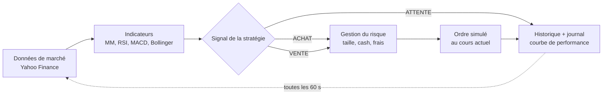

# TradeBot — bot de trading algorithmique (TIP)

Application web qui fait tourner un ou plusieurs **bots de trading** sur les **cours réels** du marché (actions américaines, suisses,
européennes, ETF, cryptos), avec un **capital fictif** choisi au départ. C'est du *paper trading* : les ordres sont simulés, aucun
argent réel n'est engagé.

Projet réalisé dans le cadre du TIP « Le trading algorithmique et l'intelligence artificielle en bourse ».

## Fonctionnalités

- **Création de bots** : capital de départ, actions suivies (recherche par nom ou listes prêtes : Tech US, SMI, Europe, crypto…),
  stratégie et ses paramètres, unité de temps des bougies (5 min → 1 jour), gestion du risque (taille de position, stop-loss,
  take-profit, frais de courtage, fractions d'actions).
- **Bot en direct** : toutes les 60 secondes, il récupère les cours réels (Yahoo Finance), calcule ses indicateurs et passe des ordres
  simulés pendant les heures d'ouverture de la bourse.
- **Dashboard** : valeur du portefeuille, performance, comparaison avec le *Buy & Hold*, liquidités, drawdown maximal, positions ouvertes
  avec gain/perte latent, graphique en chandeliers avec les indicateurs et les achats/ventes du bot.
- **Historique complet des trades** : date, prix, quantité, frais, résultat, et **la raison de chaque décision**
  (ex. « RSI à 27.4 < 30 : titre survendu »). Export CSV pour Excel.
- **Journal du bot** : chaque analyse, signal, ordre, ouverture/fermeture de marché.
- **Backtest** : rejoue une stratégie sur jusqu'à 10 ans d'historique réel et calcule rendement, drawdown, ratio de Sharpe,
  taux de réussite, profit factor… comparés au Buy & Hold.
- **Page « Comment ça marche »** : explication de l'algorithme, des indicateurs (avec formules) et des limites.
- Pause / reprise, analyse immédiate, vente manuelle d'une position, réinitialisation.

## Démarrage rapide

Prérequis : [Node.js](https://nodejs.org) **22.13 ou plus récent** (la version LTS actuelle convient).

```bash
npm install
npm run dev
```

Ouvrez ensuite <http://localhost:5173>. Le serveur (API + bot) tourne sur le port 3001, le dashboard sur le port 5173.

### Version « production » (un seul serveur)

```bash
npm install
npm run build      # génère le dashboard dans dist/web
npm start          # serveur + dashboard sur http://localhost:3001
```

> Le bot ne fonctionne que tant que le serveur tourne. Pour qu'il trade pendant des jours ou des semaines, il faut l'héberger sur une
> machine allumée en permanence (voir « Mise en ligne »).

## Comment fonctionne le bot



À chaque cycle (« tick »), pour chaque action suivie :

1. **Données** : le bot télécharge les dernières bougies et le cours actuel.
2. **Stop-loss / take-profit** : si une position est ouverte et que le cours a franchi un seuil, elle est vendue immédiatement.
3. **Signal** : uniquement quand une nouvelle bougie vient de se **clôturer** (une bougie en cours peut encore changer), la stratégie
   calcule ses indicateurs et renvoie ACHAT, VENTE ou ATTENTE, avec une explication.
4. **Exécution** : l'ordre est simulé au cours actuel. Un achat investit *x %* de la valeur du portefeuille (sans dépasser le cash),
   frais compris. Une vente solde toute la position et calcule le gain/perte réalisé, frais d'achat et de vente inclus.
5. **Suivi** : la valeur du portefeuille est enregistrée et comparée au **Buy & Hold** (les mêmes actions achetées à parts égales au
   lancement du bot).

Les ordres ne sont passés que pendant les heures d'ouverture de la bourse de chaque action. Un bot en pause continue de suivre les cours
(la valeur du portefeuille évolue) mais ne passe aucun ordre.

### Stratégies disponibles

| Stratégie | Type | Achat | Vente |
|---|---|---|---|
| Croisement de moyennes mobiles | suivi de tendance | MM courte croise MM longue vers le haut | croisement vers le bas |
| RSI | retour à la moyenne | RSI < 30 (survendu) | RSI > 70 (suracheté) |
| MACD | momentum | MACD croise sa ligne de signal vers le haut | croisement vers le bas |
| Bandes de Bollinger | statistique | clôture sous la bande basse (moyenne − 2σ) | retour à la moyenne |
| Score multi-indicateurs | modèle de décision | tendance + RSI + MACD votent, score ≥ +2 | score ≤ −2 |
| Buy & Hold | référence passive | achat au départ | jamais |

Tous les paramètres (périodes, seuils) sont réglables à la création du bot.

### Backtest

Le backtest utilise **exactement les mêmes stratégies et règles de calcul** que le bot en direct, sur l'historique réel : le signal est
calculé à la clôture d'une bougie et l'ordre est exécuté à l'ouverture de la bougie suivante ; le stop-loss et le take-profit sont
vérifiés avec le plus haut et le plus bas de chaque bougie (si les deux sont touchés, on suppose le pire cas).

## Architecture

```
server/                      Serveur Node.js (TypeScript)
  index.ts                   point d'entrée : API, dashboard, planificateur
  api.ts                     routes REST (/api/...)
  db.ts                      base SQLite : bots, positions, trades, valeur du portefeuille, journal
  config.ts                  configuration (variables d'environnement)
  market/yahoo.ts            récupération des cours (Yahoo Finance) + cache
  trading/indicators.ts      SMA, EMA, RSI, MACD, Bollinger
  trading/strategies.ts      les 6 stratégies et leurs explications
  trading/portfolio.ts       taille des ordres, frais, résultat d'une vente
  trading/engine.ts          le bot en direct
  trading/backtest.ts        le backtest
  trading/stats.ts           drawdown, volatilité, Sharpe, taux de réussite
  trading/summary.ts         chiffres clés du dashboard
shared/types.ts              types communs serveur / dashboard
web/                         Dashboard React (Vite + Tailwind CSS + TradingView Lightweight Charts)
tests/                       tests automatiques (npm test)
```

Les données sont stockées dans un fichier SQLite (`data/tradebot.db`, créé automatiquement).

### API

| Méthode | Route | Rôle |
|---|---|---|
| GET | `/api/bots` | liste des bots et leurs chiffres clés |
| POST | `/api/bots` | créer un bot |
| GET | `/api/bots/:id` | détail : résumé, positions, actions suivies |
| PATCH | `/api/bots/:id` | pause / reprise, renommer |
| POST | `/api/bots/:id/tick` | lancer une analyse immédiatement |
| POST | `/api/bots/:id/reset` | réinitialiser au capital de départ |
| DELETE | `/api/bots/:id` | supprimer |
| POST | `/api/bots/:id/positions/:symbol/close` | vendre une position manuellement |
| GET | `/api/bots/:id/trades` · `/trades.csv` | historique des trades (JSON ou CSV) |
| GET | `/api/bots/:id/equity` | évolution de la valeur du portefeuille |
| GET | `/api/bots/:id/logs` | journal du bot |
| GET | `/api/bots/:id/chart?symbol=` | bougies + indicateurs + trades d'une action |
| POST | `/api/backtest` | lancer un backtest |
| GET | `/api/market/search?q=` | rechercher une action |

## Configuration

Copiez `.env.example` en `.env` pour changer :

| Variable | Défaut | Rôle |
|---|---|---|
| `PORT` | `3001` | port du serveur |
| `TICK_SECONDS` | `60` | fréquence d'analyse (minimum 15 s) |
| `ADMIN_PASSWORD` | *(vide)* | si défini, demandé pour créer, modifier ou supprimer un bot ; la consultation reste publique |
| `DB_PATH` | `data/tradebot.db` | emplacement de la base de données |

## Mise en ligne

Pour que le bot trade en continu et que le dashboard soit accessible depuis n'importe où, il faut un hébergement qui :

- fait tourner le serveur **en permanence** (les offres gratuites qui « s'endorment » après quelques minutes sans visite arrêtent le bot) ;
- offre un **disque persistant** pour le fichier SQLite (sinon l'historique est perdu à chaque redémarrage).

Un `Dockerfile` est fourni ; il fonctionne sur la plupart des hébergeurs (Railway, Fly.io, Render avec disque, un VPS…) :

```bash
docker build -t tradebot .
docker run -d -p 3001:3001 -v tradebot-data:/data -e ADMIN_PASSWORD=choisissez-un-mot-de-passe tradebot
```

Définissez **toujours `ADMIN_PASSWORD`** quand l'application est en ligne, sinon n'importe qui pourrait supprimer vos bots.

## Tests

```bash
npm test          # indicateurs, calcul des ordres, backtest, moteur du bot, lecture des données Yahoo
npm run typecheck
```

## Limites

- Les cours Yahoo Finance sont gratuits mais non officiels ; ils peuvent être différés (~15 min selon la bourse) et Yahoo peut limiter
  les requêtes venant de certains hébergeurs.
- Pas de *slippage* (écart entre le prix attendu et le prix réellement obtenu), pas de dividendes, pas de vente à découvert.
- Le backtest souffre des biais classiques : surapprentissage (paramètres trop optimisés sur le passé) et biais du survivant.
- Si le serveur est arrêté, le bot ne rattrape pas les signaux manqués : il reprend à la bougie suivante.

> Projet pédagogique. Rien dans cette application ne constitue un conseil en investissement.
